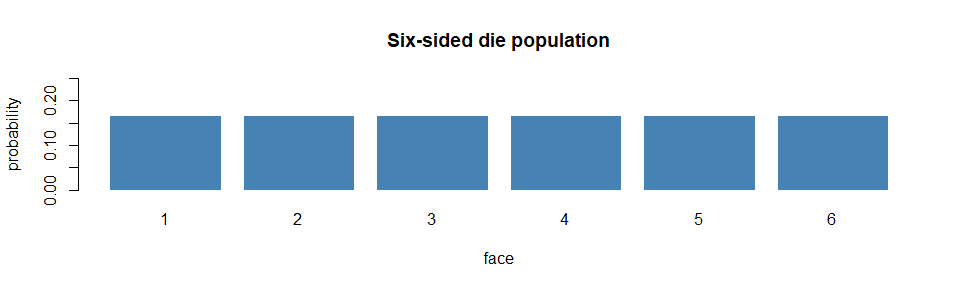
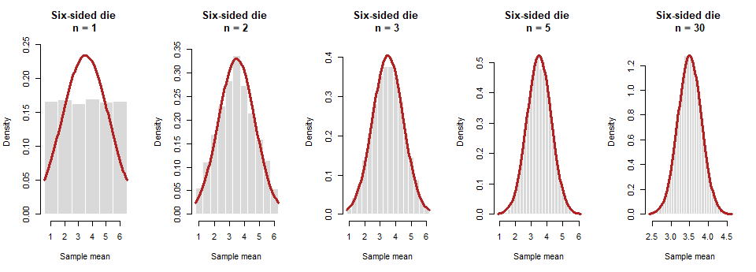
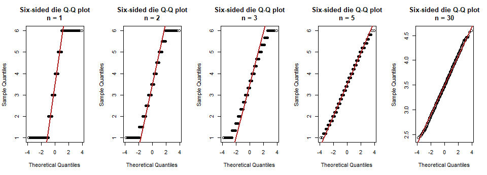
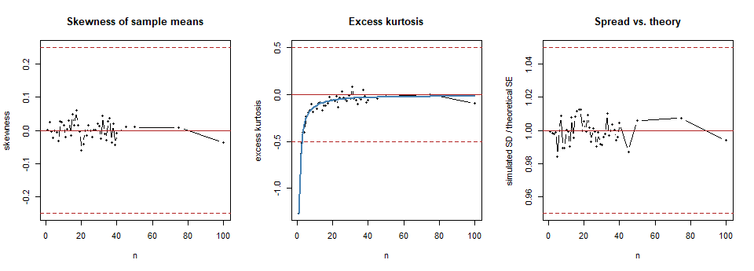

# CLT Distribution 02: Six-Sided Die


> **How to read this file.** Section 3 runs the simulation, sections 4
> and 5 show the evidence, and section 8 states my selected n. The
> reusable code lives in `R/functions.R`; this file only calls it.

## 1. Prediction

A fair die is perfectly symmetric, so I predict skewness stays near 0 at
every n. But every face is equally likely, so it has lighter tails than
a normal curve (negative excess kurtosis). I predict that kurtosis is
the check that holds it back at small n, that it shrinks toward 0 as n
grows, and that the die reaches “approximately normal” at a very small
n, such as 4.

## 2. The population

``` r
source("R/setup.R")
source("R/functions.R")

generator <- function(n) sample(1:6, n, replace = TRUE)
mu    <- 3.5
sigma <- sqrt(35 / 12)
kappa <- -6 * (6^2 + 1) / (5 * (6^2 - 1))
```

Six-sided die: each face 1 to 6 has probability 1/6.

- Mean: μ = (1 + 2 + 3 + 4 + 5 + 6) / 6 = 3.5.
- Standard deviation: σ = √(35/12) = 1.708, so the theoretical standard
  error of the mean is σ/√n.
- Shape: perfectly symmetric (skewness 0), but flat-topped. Its excess
  kurtosis is −6(6² + 1) / (5(6² − 1)) = -1.269. The excess kurtosis of
  an average of n independent rolls is this value divided by n, so I can
  compare my simulation with the theory kappa / n.

``` r
barplot(rep(1 / 6, 6), names.arg = 1:6, col = "steelblue", border = "white",
        ylim = c(0, 0.25), main = "Six-sided die population",
        xlab = "face", ylab = "probability")
```



## 3. Simulation

For every sample size n in my list (1 to 100, 44 sizes), I draw B =
10,000 samples of n rolls and keep each sample’s mean. B is the number
of repetitions; n is the size of each sample.

``` r
all_means <- simulate_all_n(generator, n_values)
results   <- summarize_means(all_means, mu, sigma)
results$good <- flag_good(results)
n_star <- smallest_good_n(results)

dir.create("results", showWarnings = FALSE)
write.csv(results, "results/02_die.csv", row.names = FALSE)
```

## 4. Results

Selected sample sizes (the full table of all 44 sizes is saved in
`results/02_die.csv`). The column `theory_kurtosis` is the theoretical
excess kurtosis, kappa / n:

``` r
key_n <- sort(unique(c(1, 2, 3, 4, 5, 10, 20, 30, 50, 100, n_star)))
show  <- results[results$n %in% key_n, c("n", "sim_mean", "theory_mean", "sim_sd",
                                         "theory_se", "sd_ratio", "skewness",
                                         "excess_kurtosis")]
show$theory_kurtosis <- kappa / show$n
show$passes <- ifelse(results$good[results$n %in% key_n], "yes", "no")
knitr::kable(show, digits = 3, row.names = FALSE)
```

| n | sim_mean | theory_mean | sim_sd | theory_se | sd_ratio | skewness | excess_kurtosis | theory_kurtosis | passes |
|---:|---:|---:|---:|---:|---:|---:|---:|---:|:---|
| 1 | 3.496 | 3.5 | 1.707 | 1.708 | 0.999 | 0.002 | -1.268 | -1.269 | no |
| 2 | 3.485 | 3.5 | 1.206 | 1.208 | 0.999 | 0.026 | -0.627 | -0.634 | no |
| 3 | 3.507 | 3.5 | 0.984 | 0.986 | 0.998 | -0.004 | -0.405 | -0.423 | yes |
| 4 | 3.502 | 3.5 | 0.853 | 0.854 | 0.999 | -0.021 | -0.402 | -0.317 | yes |
| 5 | 3.503 | 3.5 | 0.752 | 0.764 | 0.984 | -0.001 | -0.233 | -0.254 | yes |
| 10 | 3.503 | 3.5 | 0.540 | 0.540 | 1.000 | 0.017 | -0.127 | -0.127 | yes |
| 20 | 3.498 | 3.5 | 0.384 | 0.382 | 1.005 | -0.060 | -0.061 | -0.063 | yes |
| 30 | 3.498 | 3.5 | 0.309 | 0.312 | 0.992 | 0.014 | -0.047 | -0.042 | yes |
| 50 | 3.498 | 3.5 | 0.243 | 0.242 | 1.006 | 0.010 | -0.022 | -0.025 | yes |
| 100 | 3.499 | 3.5 | 0.170 | 0.171 | 0.994 | -0.036 | -0.096 | -0.013 | yes |

## 5. Plots

**Histograms of the sample means**, with the theoretical normal curve
N(μ, σ/√n) in red. I show the same sample sizes in every analysis (1, 2,
5, 30) plus my selected n. Because a die only produces whole numbers,
`step = 1` lines the bars up with the values the sample mean can
actually take:

``` r
show_n <- sort(unique(c(1, 2, 5, 30, n_star)))
plot_histograms(all_means, show_n, mu, sigma, "Six-sided die", step = 1)
```



**Q–Q plots** (points on the red line = normal):

``` r
plot_qq(all_means, show_n, "Six-sided die")
```



These sample sizes are a sample of the picture: 1 is the raw population,
2 is the smallest amount of averaging, 5 is a small sample, 30 is the
classic rule of thumb, and the last one is my selected n. Every n from 1
to 100 appears in the diagnostics chart below and in
`results/02_die.csv`, and you can see the sampling distribution at any n
in the [Interactive Sampling Distribution
Explorer](https://nprodhuturi.github.io/clt-monte-carlo/interactive/explorer.html).

**Diagnostics across every n.** Dashed lines mark my “approximately
normal” limits (defined in section 6):

``` r
par(mfrow = c(1, 3))
plot(results$n, results$skewness, type = "b", pch = 16, cex = 0.6,
     ylim = range(c(results$skewness, -0.25, 0.25)),
     xlab = "n", ylab = "skewness", main = "Skewness of sample means")
abline(h = c(-0.25, 0, 0.25), lty = c(2, 1, 2), col = "firebrick")

plot(results$n, results$excess_kurtosis, type = "b", pch = 16, cex = 0.6,
     ylim = range(c(results$excess_kurtosis, -0.5, 0.5)),
     xlab = "n", ylab = "excess kurtosis", main = "Excess kurtosis")
abline(h = c(-0.5, 0, 0.5), lty = c(2, 1, 2), col = "firebrick")
lines(results$n, kappa / results$n, col = "steelblue", lwd = 2)

plot(results$n, results$sd_ratio, type = "b", pch = 16, cex = 0.6,
     ylim = range(c(results$sd_ratio, 0.95, 1.05)),
     xlab = "n", ylab = "simulated SD / theoretical SE", main = "Spread vs. theory")
abline(h = c(0.95, 1, 1.05), lty = c(2, 1, 2), col = "firebrick")
```



In the middle chart, the blue line is the theoretical excess kurtosis
(kappa / n); the black points are my simulation.

## 6. My definition of “approximately normal”

I use the same rule in every analysis. A sample size n counts as
approximately normal when **all four** of these hold:

1.  The histogram is bell-shaped and the Q–Q plot is close to the line.
2.  \|skewness\| ≤ 0.25.
3.  \|excess kurtosis\| ≤ 0.5.
4.  The simulated SD is within 5% of the theoretical SE (σ/√n).

My selected n is the smallest n that passes and stays passing for every
larger n I tested. The reasons for each cutoff are in
[01_standard_normal.md](01_standard_normal.md).

## 7. Interpretation

``` r
at_star  <- results[results$n == n_star, ]
below    <- results[results$n == n_star - 1, ]
at_one   <- results[results$n == 1, ]
max_skew <- max(abs(results$skewness))
sd_lo    <- min(results$sd_ratio)
sd_hi    <- max(results$sd_ratio)
max_mean_err <- max(abs(results$sim_mean - results$theory_mean))
kurt_gap <- max(abs(results$excess_kurtosis - kappa / results$n))
```

- **Shape.** At n = 1 the histogram is six equal bars and the Q–Q plot
  is a staircase, because a single roll can only be 1 to 6. By n = 5 the
  bars form a bell and the steps in the Q–Q plot are small and follow
  the line; by n = 30 it looks practically straight.
- **Mean.** The simulated mean never differs from μ = 3.5 by more than
  0.015.
- **Spread.** The simulated SD divided by the theoretical SE stays
  between 0.984 and 1.013, so the formula σ/√n holds at every n.
- **Skewness.** Skewness is symmetric by design: it stays within ±0.061
  at every n, which is just simulation noise.
- **Kurtosis decides it.** At n = 1 the excess kurtosis is -1.268
  (theory -1.269), far outside my ±0.5 limit. It shrinks like kappa / n,
  and my simulated values follow that line apart from random noise (the
  largest gap is 0.122, compared with a noise level of about ±0.05 per
  value). The kurtosis limit is first met at n = 3.

**CLT assumptions.** Rolls are independent and identically distributed,
and a die has finite variance (it is bounded), so every assumption is
met.

**Limitations / surprises.** The surprise is which check fails. The die
has no skew, so the usual worry about a long tail does not apply.
Instead it fails because it has too few extreme values (light tails),
and averaging fixes that quickly. Also, because the die is discrete, the
sample mean can only take certain values at small n, which is why the
histograms and Q–Q plots look blocky there.

## 8. Selected n and justification

**Selected n=n_star**$$\boxed{n = 3}$$

- **Evidence at n = 3.** Skewness -0.004 (limit ±0.25), excess kurtosis
  -0.405 (limit ±0.5), and SD ratio 0.998 (limit 1 ± 0.05). The
  histogram follows the normal curve, and the Q–Q plot follows the line
  apart from small steps caused by the die’s discrete values.
- **Why not smaller.** At n = 2, the excess kurtosis is -0.627, outside
  my ±0.5 limit.
- **It stays passing.** Every larger n I tested, up to n = 100, also
  passes.
- **Is the number 30?** No. The die needs only about n = 3, so 30 is
  roughly 10 times more than necessary.
