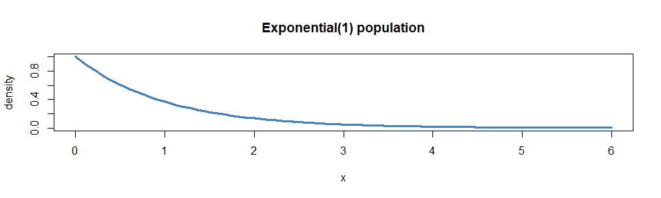
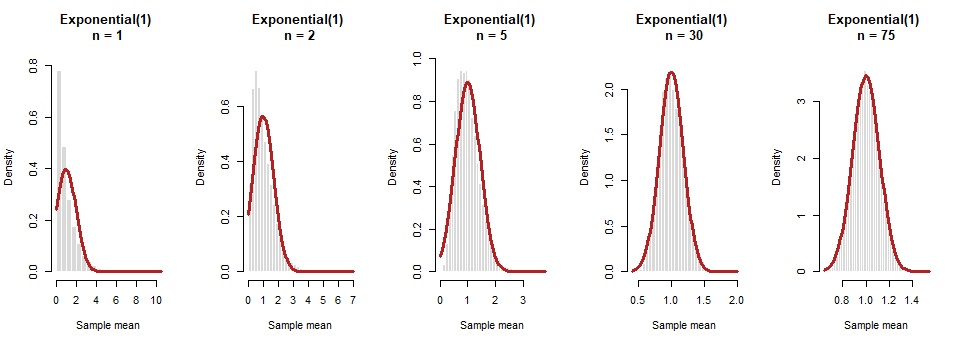
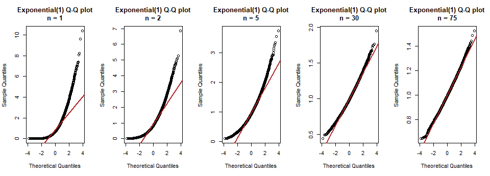
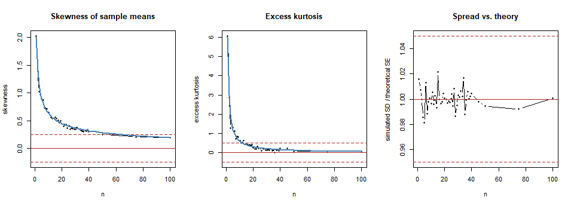

# CLT Distribution 3: Exponential


> **How to read this file.** Section 3 runs the simulation, sections 4
> and 5 show the evidence, and section 8 states my selected n. The
> reusable code lives in `R/functions.R`; this file only calls it.

## 1. Prediction

The Exponential is strongly right-skewed: lots of small values and a
long tail of big ones. I predict that skewness is what holds it back,
and that it needs far more observations than the die. I guess the
selected n will be somewhere around 70 to 75.

## 2. The population

``` r
source("R/setup.R")
source("R/functions.R")

generator <- function(n) rexp(n, rate = 1)
mu    <- 1
sigma <- 1
```

Exponential with rate λ = 1: mean μ = 1/λ = 1, standard deviation σ =
1/λ = 1, so the theoretical standard error of the mean is σ/√n = 1/√n.

Its shape is very skewed: skewness 2 and excess kurtosis 6. For an
average of n independent observations these shrink to **2/√n** and
**6/n**, so I can compare my simulation with that theory.

``` r
curve(dexp(x, rate = 1), from = 0, to = 6, lwd = 3, col = "steelblue",
      main = "Exponential(1) population", xlab = "x", ylab = "density")
```



## 3. Simulation

For every sample size n in my list (1 to 100, 44 sizes), I draw B =
10,000 samples of n observations and keep each sample’s mean. B is the
number of repetitions; n is the size of each sample.

``` r
all_means <- simulate_all_n(generator, n_values)
results   <- summarize_means(all_means, mu, sigma)
results$good <- flag_good(results)
n_star <- smallest_good_n(results)

dir.create("results", showWarnings = FALSE)
write.csv(results, "results/03_exponential.csv", row.names = FALSE)
```

## 4. Results

Selected sample sizes (the full table of all 44 sizes is saved in
`results/03_exponential.csv`). The columns `theory_skew` and
`theory_kurtosis` are 2/√n and 6/n:

``` r
key_n <- sort(unique(c(1, 2, 5, 10, 20, 30, 40, 50, 75, 100, n_star)))
show  <- results[results$n %in% key_n, c("n", "sim_mean", "theory_mean", "sim_sd",
                                         "theory_se", "sd_ratio", "skewness",
                                         "excess_kurtosis")]
show$theory_skew     <- 2 / sqrt(show$n)
show$theory_kurtosis <- 6 / show$n
show$passes <- ifelse(results$good[results$n %in% key_n], "yes", "no")
knitr::kable(show, digits = 3, row.names = FALSE)
```

| n | sim_mean | theory_mean | sim_sd | theory_se | sd_ratio | skewness | excess_kurtosis | theory_skew | theory_kurtosis | passes |
|---:|---:|---:|---:|---:|---:|---:|---:|---:|---:|:---|
| 1 | 1.010 | 1 | 1.016 | 1.000 | 1.016 | 2.022 | 6.066 | 2.000 | 6.00 | no |
| 2 | 1.005 | 1 | 0.712 | 0.707 | 1.008 | 1.386 | 2.875 | 1.414 | 3.00 | no |
| 5 | 0.999 | 1 | 0.439 | 0.447 | 0.981 | 0.897 | 1.321 | 0.894 | 1.20 | no |
| 10 | 0.997 | 1 | 0.315 | 0.316 | 0.997 | 0.643 | 0.635 | 0.632 | 0.60 | no |
| 20 | 0.998 | 1 | 0.224 | 0.224 | 1.001 | 0.441 | 0.244 | 0.447 | 0.30 | no |
| 30 | 1.000 | 1 | 0.183 | 0.183 | 1.003 | 0.346 | 0.137 | 0.365 | 0.20 | no |
| 40 | 1.002 | 1 | 0.159 | 0.158 | 1.005 | 0.303 | 0.224 | 0.316 | 0.15 | no |
| 50 | 0.999 | 1 | 0.141 | 0.141 | 0.995 | 0.252 | 0.063 | 0.283 | 0.12 | no |
| 75 | 0.998 | 1 | 0.115 | 0.115 | 0.992 | 0.208 | 0.067 | 0.231 | 0.08 | yes |
| 100 | 1.000 | 1 | 0.100 | 0.100 | 1.001 | 0.192 | 0.083 | 0.200 | 0.06 | yes |

## 5. Plots

**Histograms of the sample means**, with the theoretical normal curve
N(μ, σ/√n) in red. I show the same sample sizes in every analysis (1, 2,
5, 30) plus my selected n:

``` r
show_n <- sort(unique(c(1, 2, 5, 30, n_star)))
plot_histograms(all_means, show_n, mu, sigma, "Exponential(1)")
```



**Q–Q plots** (points on the red line = normal):

``` r
plot_qq(all_means, show_n, "Exponential(1)")
```



These sample sizes are a sample of the picture: 1 is the raw population,
2 is the smallest amount of averaging, 5 is a small sample, 30 is the
classic rule of thumb, and the last one is my selected n. Every n from 1
to 100 appears in the diagnostics chart below and in
`results/03_exponential.csv`, and you can see the sampling distribution
at any n in the [Interactive Sampling Distribution
Explorer](https://nprodhuturi.github.io/clt-monte-carlo/interactive/explorer.html).

**Diagnostics across every n.** Dashed lines mark my “approximately
normal” limits (defined in section 6). The blue lines are the theory,
2/√n for skewness and 6/n for kurtosis:

``` r
par(mfrow = c(1, 3))
plot(results$n, results$skewness, type = "b", pch = 16, cex = 0.6,
     ylim = range(c(results$skewness, -0.25, 0.25)),
     xlab = "n", ylab = "skewness", main = "Skewness of sample means")
abline(h = c(-0.25, 0, 0.25), lty = c(2, 1, 2), col = "firebrick")
lines(results$n, 2 / sqrt(results$n), col = "steelblue", lwd = 2)

plot(results$n, results$excess_kurtosis, type = "b", pch = 16, cex = 0.6,
     ylim = range(c(results$excess_kurtosis, -0.5, 0.5)),
     xlab = "n", ylab = "excess kurtosis", main = "Excess kurtosis")
abline(h = c(-0.5, 0, 0.5), lty = c(2, 1, 2), col = "firebrick")
lines(results$n, 6 / results$n, col = "steelblue", lwd = 2)

plot(results$n, results$sd_ratio, type = "b", pch = 16, cex = 0.6,
     ylim = range(c(results$sd_ratio, 0.95, 1.05)),
     xlab = "n", ylab = "simulated SD / theoretical SE", main = "Spread vs. theory")
abline(h = c(0.95, 1, 1.05), lty = c(2, 1, 2), col = "firebrick")
```



## 6. My definition of “approximately normal”

I use the same rule in every analysis. A sample size n counts as
approximately normal when **all four** of these hold:

1.  The histogram is bell-shaped and the Q–Q plot is close to the line.
2.  \|skewness\| ≤ 0.25.
3.  \|excess kurtosis\| ≤ 0.5.
4.  The simulated SD is within 5% of the theoretical SE (σ/√n).

My selected n is the smallest n that passes and stays passing for every
larger n I tested, so a lucky pass at one n doesn’t count. The reasons
for each cutoff are in [01_standard_normal.md](01_standard_normal.md).

## 7. Interpretation

``` r
at_star  <- results[results$n == n_star, ]
before   <- results[results$n < n_star, ]
below    <- before[nrow(before), ]
at_one   <- results[results$n == 1, ]
sd_lo    <- min(results$sd_ratio)
sd_hi    <- max(results$sd_ratio)
max_mean_err <- max(abs(results$sim_mean - results$theory_mean))
skew_gap <- max(abs(results$skewness - 2 / sqrt(results$n)))
n_theory <- ceiling((2 / 0.25)^2)
```

- **Shape.** At n = 1 the histogram is the Exponential itself: a tall
  spike near 0 and a long right tail, and the Q–Q plot bends sharply
  away from the line. As n grows the pile of sample means becomes less
  lopsided, and by n = 30 it is bell-like but still has a slightly
  longer right tail.
- **Mean.** The simulated mean never differs from μ = 1 by more than
  0.01. Averaging doesn’t change the center.
- **Spread.** The simulated SD divided by the theoretical SE stays
  between 0.981 and 1.022, so σ/√n holds at every n.
- **Skewness decides it.** At n = 1 the skewness is 2.022 (theory 2). It
  falls like 2/√n, and my simulation follows that curve (largest gap
  0.13). The kurtosis falls like 6/n, which is much faster, so it is
  never the problem here.
- **Theory check.** Setting 2/√n = 0.25 gives n = (2/0.25)² = 64. My
  list of sample sizes only has 45, 50, 75 and 100 above 40, so the
  first size I tested that is at or past that point and stays passing is
  n = 75.

**CLT assumptions.** The observations are independent and identically
distributed with finite variance, so every assumption is met. The CLT is
true here; it is just slow because of the skew.

**Limitations / surprises.** The surprise is how far the classic n = 30
is from the finish line: at n = 30 the skewness is still about 0.35,
above my 0.25 limit. Also, the passing point depends on my cutoff. Near
the limit the simulated skewness only changes slowly with n, and random
noise of about ±0.02 can move the point where it first stays under 0.25,
so I treat n = 75 as a rough answer and not an exact one.

## 8. Selected n and justification

**Selected n = 75.**

$$\boxed{n = 75}$$

- **Evidence at n = 75.** Skewness 0.208 (limit ±0.25), excess kurtosis
  0.067 (limit ±0.5), and SD ratio 0.992 (limit 1 ± 0.05). The histogram
  follows the normal curve closely, and the Q–Q plot follows the line.
- **Why not smaller.** At n = 50, the skewness is 0.252, which is
  outside my ±0.25 limit (the theory says it should be about 0.283).
- **It stays passing.** Every larger n I tested, up to n = 100, also
  passes.
- **Is the number 30?** No. For the Exponential, 30 is too small: at n =
  30 the skewness is still about 0.35. By the theory I need about n =
  64, so 30 is roughly 2.5 times too small.
