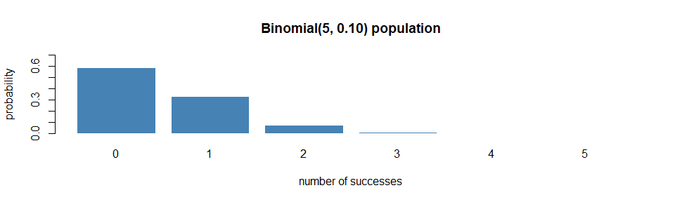
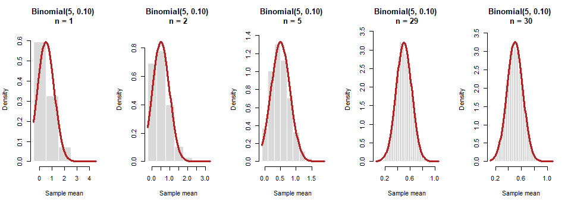
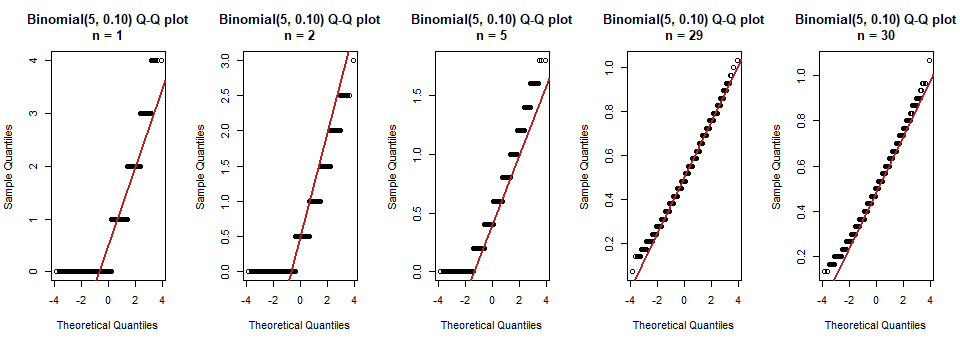
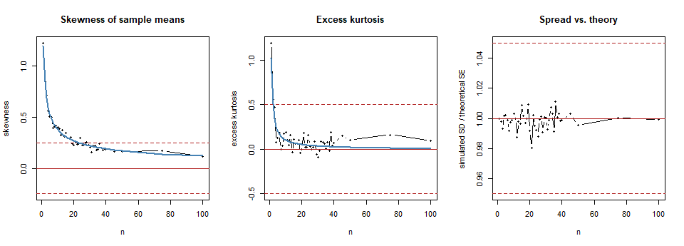

# CLT Distribution 4: Binomial Small


> **How to read this file.** Section 3 runs the simulation, sections 4
> and 5 show the evidence, and section 8 states my selected n. The
> reusable code lives in `R/functions.R`; this file only calls it.

## 1. Prediction

Each observation is a count of successes in 5 trials with a 10% chance
each, so it is mostly 0 or 1 and rarely 2 or more. That is a skewed,
discrete population (only 6 possible values). I predict that skewness is
what holds it back, and that it needs more observations than the die but
fewer than the Exponential, so close to 30.

## 2. The population

``` r
source("R/setup.R")
source("R/functions.R")

generator <- function(n) rbinom(n, size = 5, prob = 0.10)
mu    <- 5 * 0.10
sigma <- sqrt(5 * 0.10 * 0.90)
skew1 <- (1 - 2 * 0.10) / sigma
kurt1 <- (1 - 6 * 0.10 * 0.90) / (5 * 0.10 * 0.90)
```

Binomial with 5 trials and success probability 0.10: mean μ = 5 × 0.10 =
0.5, standard deviation σ = √(5 × 0.10 × 0.90) = 0.671, so the
theoretical standard error of the mean is σ/√n.

Its shape is skewed to the right: skewness (1 − 2p)/σ = 1.193 and excess
kurtosis (1 − 6pq)/(npq) = 1.022. For an average of n independent
observations these shrink to **1.19/√n** and **1.02/n**, so I can
compare my simulation with that theory.

``` r
barplot(dbinom(0:5, 5, 0.10), names.arg = 0:5, col = "steelblue", border = "white",
        ylim = c(0, 0.7), main = "Binomial(5, 0.10) population",
        xlab = "number of successes", ylab = "probability")
```



## 3. Simulation

For every sample size n in my list (1 to 100, 44 sizes), I draw B =
10,000 samples of n observations and keep each sample’s mean. B is the
number of repetitions; n is the size of each sample.

``` r
all_means <- simulate_all_n(generator, n_values)
results   <- summarize_means(all_means, mu, sigma)
results$good <- flag_good(results)
n_star <- smallest_good_n(results)

dir.create("results", showWarnings = FALSE)
write.csv(results, "results/04_binomial_small.csv", row.names = FALSE)
```

## 4. Results

Selected sample sizes (the full table of all 44 sizes is saved in
`results/04_binomial_small.csv`). The columns `theory_skew` and
`theory_kurtosis` are the formulas above divided by √n and n:

``` r
key_n <- sort(unique(c(1, 2, 5, 10, 20, 30, 40, 50, 75, 100, n_star)))
show  <- results[results$n %in% key_n, c("n", "sim_mean", "theory_mean", "sim_sd",
                                         "theory_se", "sd_ratio", "skewness",
                                         "excess_kurtosis")]
show$theory_skew     <- skew1 / sqrt(show$n)
show$theory_kurtosis <- kurt1 / show$n
show$passes <- ifelse(results$good[results$n %in% key_n], "yes", "no")
knitr::kable(show, digits = 3, row.names = FALSE)
```

| n | sim_mean | theory_mean | sim_sd | theory_se | sd_ratio | skewness | excess_kurtosis | theory_skew | theory_kurtosis | passes |
|---:|---:|---:|---:|---:|---:|---:|---:|---:|---:|:---|
| 1 | 0.496 | 0.5 | 0.671 | 0.671 | 1.000 | 1.223 | 1.191 | 1.193 | 1.022 | no |
| 2 | 0.502 | 0.5 | 0.473 | 0.474 | 0.998 | 0.845 | 0.562 | 0.843 | 0.511 | no |
| 5 | 0.499 | 0.5 | 0.301 | 0.300 | 1.002 | 0.507 | 0.123 | 0.533 | 0.204 | no |
| 10 | 0.500 | 0.5 | 0.213 | 0.212 | 1.003 | 0.403 | 0.190 | 0.377 | 0.102 | no |
| 20 | 0.502 | 0.5 | 0.149 | 0.150 | 0.992 | 0.229 | 0.002 | 0.267 | 0.051 | yes |
| 29 | 0.498 | 0.5 | 0.125 | 0.125 | 1.001 | 0.223 | -0.053 | 0.221 | 0.035 | yes |
| 30 | 0.500 | 0.5 | 0.122 | 0.122 | 1.000 | 0.208 | -0.086 | 0.218 | 0.034 | yes |
| 40 | 0.500 | 0.5 | 0.106 | 0.106 | 0.999 | 0.186 | 0.071 | 0.189 | 0.026 | yes |
| 50 | 0.501 | 0.5 | 0.094 | 0.095 | 0.996 | 0.161 | 0.104 | 0.169 | 0.020 | yes |
| 75 | 0.500 | 0.5 | 0.077 | 0.077 | 1.000 | 0.173 | 0.163 | 0.138 | 0.014 | yes |
| 100 | 0.498 | 0.5 | 0.067 | 0.067 | 0.999 | 0.118 | 0.095 | 0.119 | 0.010 | yes |

## 5. Plots

**Histograms of the sample means**, with the theoretical normal curve
N(μ, σ/√n) in red. I show the same sample sizes in every analysis (1, 2,
5, 30) plus my selected n. The population only produces whole numbers,
so `step = 1` lines the bars up with the values the sample mean can
actually take:

``` r
show_n <- sort(unique(c(1, 2, 5, 30, n_star)))
plot_histograms(all_means, show_n, mu, sigma, "Binomial(5, 0.10)", step = 1)
```



**Q–Q plots** (points on the red line = normal):

``` r
plot_qq(all_means, show_n, "Binomial(5, 0.10)")
```



These sample sizes are a sample of the picture: 1 is the raw population,
2 is the smallest amount of averaging, 5 is a small sample, 30 is the
classic rule of thumb, and the last one is my selected n. Every n from 1
to 100 appears in the diagnostics chart below and in
`results/04_binomial_small.csv`, and you can see the sampling
distribution at any n in the [Interactive Sampling Distribution
Explorer](https://nprodhuturi.github.io/clt-monte-carlo/interactive/explorer.html).

**Diagnostics across every n.** Dashed lines mark my “approximately
normal” limits (defined in section 6). The blue lines are the theory
(skewness divided by √n, kurtosis divided by n):

``` r
par(mfrow = c(1, 3))
plot(results$n, results$skewness, type = "b", pch = 16, cex = 0.6,
     ylim = range(c(results$skewness, -0.25, 0.25)),
     xlab = "n", ylab = "skewness", main = "Skewness of sample means")
abline(h = c(-0.25, 0, 0.25), lty = c(2, 1, 2), col = "firebrick")
lines(results$n, skew1 / sqrt(results$n), col = "steelblue", lwd = 2)

plot(results$n, results$excess_kurtosis, type = "b", pch = 16, cex = 0.6,
     ylim = range(c(results$excess_kurtosis, -0.5, 0.5)),
     xlab = "n", ylab = "excess kurtosis", main = "Excess kurtosis")
abline(h = c(-0.5, 0, 0.5), lty = c(2, 1, 2), col = "firebrick")
lines(results$n, kurt1 / results$n, col = "steelblue", lwd = 2)

plot(results$n, results$sd_ratio, type = "b", pch = 16, cex = 0.6,
     ylim = range(c(results$sd_ratio, 0.95, 1.05)),
     xlab = "n", ylab = "simulated SD / theoretical SE", main = "Spread vs. theory")
abline(h = c(0.95, 1, 1.05), lty = c(2, 1, 2), col = "firebrick")
```



## 6. My definition of “approximately normal”

I use the same rule in every analysis. A sample size n counts as
approximately normal when **all four** of these hold:

1.  The histogram is bell-shaped and the Q–Q plot is close to the line.
2.  \|skewness\| ≤ 0.25.
3.  \|excess kurtosis\| ≤ 0.5.
4.  The simulated SD is within 5% of the theoretical SE (σ/√n).

My selected n is the smallest n that passes and stays passing for every
larger n I tested, so a lucky pass at one n doesn’t count. The reasons
for each cutoff are in [01_standard_normal.md](01_standard_normal.md).

## 7. Interpretation

``` r
at_star  <- results[results$n == n_star, ]
before   <- results[results$n < n_star, ]
below    <- before[nrow(before), ]
at_one   <- results[results$n == 1, ]
sd_lo    <- min(results$sd_ratio)
sd_hi    <- max(results$sd_ratio)
max_mean_err <- max(abs(results$sim_mean - results$theory_mean))
skew_gap <- max(abs(results$skewness - skew1 / sqrt(results$n)))
n_theory <- ceiling((skew1 / 0.25)^2)
```

- **Shape.** At n = 1 about 59% of the observations are 0, so the
  histogram is a tall bar at 0 with a few bars to its right, and the Q–Q
  plot is a staircase. As n grows the sample means fill in between the
  whole numbers, and by n = 30 the histogram is bell-like with only a
  small right lean.
- **Mean.** The simulated mean never differs from μ = 0.5 by more than
  0.006.
- **Spread.** The simulated SD divided by the theoretical SE stays
  between 0.981 and 1.011, so σ/√n holds at every n.
- **Skewness decides it.** At n = 1 the skewness is 1.223 (theory
  1.193). It falls like 1.19/√n, and my simulation follows that curve
  (largest gap 0.056). Kurtosis falls like 1.02/n, which is faster, so
  skewness is the check that matters.
- **Theory check.** Setting 1.193/√n = 0.25 gives n = (1.193/0.25)²
  = 23. My list includes every n from 1 to 40, so my selected n = 29
  should land near that. It lands a little later than the theory because
  near the limit the simulated skewness bounces around 0.25, and my rule
  needs it to stay under 0.25 for every larger n.

**CLT assumptions.** The observations are independent and identically
distributed with finite variance, so every assumption is met.

**Limitations / surprises.** The surprise is that a population with only
six possible values and a tiny success chance still reaches a normal
shape at a modest n. The catch is that the sample mean stays discrete,
so the Q–Q plot keeps small steps even when the numbers pass. Also, near
the limit the skewness changes slowly with n, and random noise of about
±0.02 can move my selected n by a few steps, so I treat n = 29 as a
rough answer and not an exact one.

## 8. Selected n and justification

**Selected n = 29.**

$$\boxed{n = 29}$$

- **Evidence at n = 29.** Skewness 0.223 (limit ±0.25), excess kurtosis
  -0.053 (limit ±0.5), and SD ratio 1.001 (limit 1 ± 0.05). The
  histogram follows the normal curve, and the Q–Q plot follows the line
  apart from small steps caused by the discrete values.
- **Why not smaller.** At n = 28, the skewness is 0.254, just outside my
  ±0.25 limit. This is a near miss caused by noise: the theory value
  there is 0.225, which is under 0.25. Sizes from about n = 23 up to 28
  sit right on the limit, so noise pushes some over and some under.
  Sizes below n = 23 can pass by luck (for example n = 20 passes at
  0.229, but the theory there is 0.267), so they don’t count under my
  “stays passing” rule.
- **It stays passing.** Every larger n I tested, up to n = 100, also
  passes.
- **Is the number 30?** Close to it. The theory says about n = 23 and my
  simulation says n = 29, so 30 is a good rule of thumb for this
  population (unlike the die, where it was far too big, or the
  Exponential, where it was too small).
