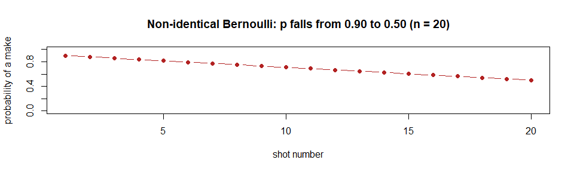
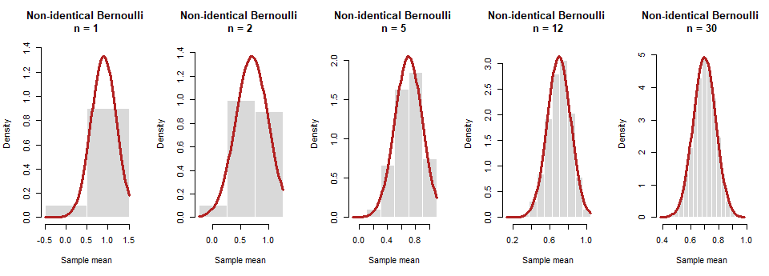
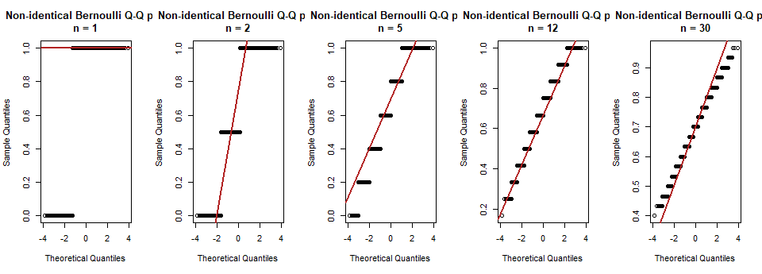
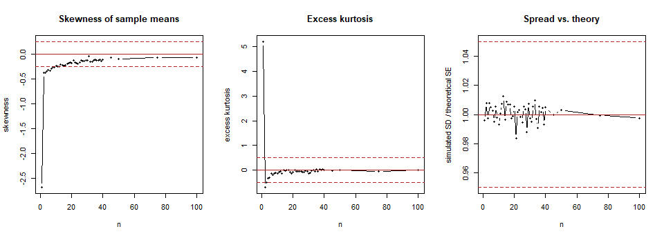
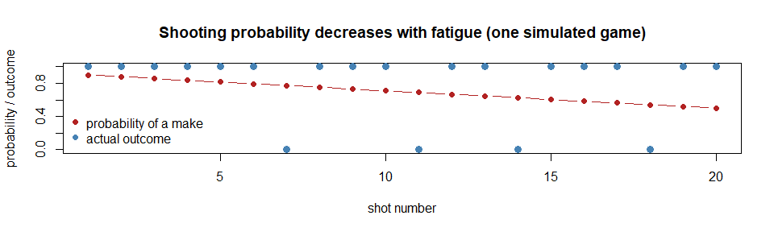

# CLT Distribution 6 (Extra Credit): Non-identical Bernoulli


> **How to read this file.** Section 3 runs the simulation, sections 4
> and 5 show the evidence, and section 8 states my selected n. The
> reusable code lives in `R/functions.R`; this file only calls it.

## 1. Prediction

This one breaks the “identical” part of the CLT. Observation i is a
Bernoulli (0 or 1) whose success chance falls steadily from 0.90 for the
first observation to 0.50 for the last, like a basketball player getting
tired during a game. The observations are still independent, so I
predict the CLT still works, but the mean and spread need a new formula
because every observation has its own probability. I predict a selected
n of about 10 to 15, similar to a Bernoulli with p around 0.7.

## 2. The population

``` r
source("R/setup.R")
source("R/functions.R")

make_p <- function(n) seq(from = 0.90, to = 0.50, length.out = n)
generator <- function(n) rbinom(n, size = 1, prob = make_p(n))

n_names  <- as.character(n_values)
mu_n     <- sapply(n_values, function(n) mean(make_p(n)))
sigma_n  <- sapply(n_values, function(n) sqrt(mean(make_p(n) * (1 - make_p(n)))))
names(mu_n) <- n_names
names(sigma_n) <- n_names
```

A sample of size n is a game of n shots. Shot i has success probability
p_i, and the p_i are spaced evenly from 0.90 down to 0.50 (the same
setup as the teacher’s basketball example). The sample mean is the
shooting percentage.

Because the p_i differ, the formulas change:

- Mean of the sample mean: the average of the p_i, which is 0.7 for a
  20-shot game (and 0.70 for every n of 2 or more; the n = 1 sample is
  just the first shot, p = 0.90).
- Standard error: √(Σ p_i(1 − p_i)) / n. I write this as σ_n/√n, where
  σ_n = √(average of p_i(1 − p_i)) is the effective standard deviation
  of one shot at that n. It is about 0.442 for n = 20, and the code
  below passes it in for every n.

``` r
plot(1:20, make_p(20), type = "b", pch = 19, col = "firebrick", ylim = c(0, 1),
     xlab = "shot number", ylab = "probability of a make",
     main = "Non-identical Bernoulli: p falls from 0.90 to 0.50 (n = 20)")
```



## 3. Simulation

For every sample size n in my list (1 to 100, 44 sizes), I simulate B =
10,000 games of n shots and keep each game’s shooting percentage. B is
the number of repetitions; n is the size of each sample.

``` r
all_means <- simulate_all_n(generator, n_values)
results   <- summarize_means(all_means, mu_n, sigma_n)
results$good <- flag_good(results)
n_star <- smallest_good_n(results)

dir.create("results", showWarnings = FALSE)
write.csv(results, "results/06_nonidentical_bernoulli.csv", row.names = FALSE)
```

## 4. Results

Selected sample sizes (the full table of all 44 sizes is saved in
`results/06_nonidentical_bernoulli.csv`). `theory_mean` is the average
of the p_i and `theory_se` is √(Σ p_i(1 − p_i)) / n:

``` r
key_n <- sort(unique(c(1, 2, 5, 10, 20, 30, 40, 50, 100, n_star)))
show  <- results[results$n %in% key_n, c("n", "sim_mean", "theory_mean", "sim_sd",
                                         "theory_se", "sd_ratio", "skewness",
                                         "excess_kurtosis")]
show$passes <- ifelse(results$good[results$n %in% key_n], "yes", "no")
knitr::kable(show, digits = 3, row.names = FALSE)
```

| n | sim_mean | theory_mean | sim_sd | theory_se | sd_ratio | skewness | excess_kurtosis | passes |
|---:|---:|---:|---:|---:|---:|---:|---:|:---|
| 1 | 0.901 | 0.9 | 0.299 | 0.300 | 0.996 | -2.683 | 5.201 | no |
| 2 | 0.698 | 0.7 | 0.294 | 0.292 | 1.008 | -0.375 | -0.706 | no |
| 5 | 0.697 | 0.7 | 0.196 | 0.195 | 1.005 | -0.314 | -0.298 | no |
| 10 | 0.700 | 0.7 | 0.138 | 0.139 | 0.993 | -0.241 | -0.129 | yes |
| 12 | 0.702 | 0.7 | 0.128 | 0.127 | 1.007 | -0.245 | -0.045 | yes |
| 20 | 0.698 | 0.7 | 0.099 | 0.099 | 1.005 | -0.182 | -0.067 | yes |
| 30 | 0.700 | 0.7 | 0.081 | 0.081 | 0.997 | -0.120 | -0.122 | yes |
| 40 | 0.700 | 0.7 | 0.070 | 0.070 | 1.005 | -0.106 | -0.005 | yes |
| 50 | 0.700 | 0.7 | 0.063 | 0.063 | 1.003 | -0.098 | 0.000 | yes |
| 100 | 0.701 | 0.7 | 0.044 | 0.044 | 0.998 | -0.072 | 0.002 | yes |

## 5. Plots

**Histograms of the sample means**, with the theoretical normal curve
N(mean of the p_i, SE) in red. I show the same sample sizes in every
analysis (1, 2, 5, 30) plus my selected n. A shooting percentage can
only be 0, 1/n, 2/n and so on, so `step = 1` lines the bars up with
those values:

``` r
show_n <- sort(unique(c(1, 2, 5, 30, n_star)))
plot_histograms(all_means, show_n, mu_n, sigma_n, "Non-identical Bernoulli", step = 1)
```



**Q–Q plots** (points on the red line = normal):

``` r
plot_qq(all_means, show_n, "Non-identical Bernoulli")
```



You can try any n yourself in the [Interactive Sampling Distribution
Explorer](https://nprodhuturi.github.io/clt-monte-carlo/interactive/explorer.html),
which includes this population.

**Diagnostics across every n.** Dashed lines mark my “approximately
normal” limits (defined in section 6):

``` r
par(mfrow = c(1, 3))
plot(results$n, results$skewness, type = "b", pch = 16, cex = 0.6,
     ylim = range(c(results$skewness, -0.25, 0.25)),
     xlab = "n", ylab = "skewness", main = "Skewness of sample means")
abline(h = c(-0.25, 0, 0.25), lty = c(2, 1, 2), col = "firebrick")

plot(results$n, results$excess_kurtosis, type = "b", pch = 16, cex = 0.6,
     ylim = range(c(results$excess_kurtosis, -0.5, 0.5)),
     xlab = "n", ylab = "excess kurtosis", main = "Excess kurtosis")
abline(h = c(-0.5, 0, 0.5), lty = c(2, 1, 2), col = "firebrick")

plot(results$n, results$sd_ratio, type = "b", pch = 16, cex = 0.6,
     ylim = range(c(results$sd_ratio, 0.95, 1.05)),
     xlab = "n", ylab = "simulated SD / theoretical SE", main = "Spread vs. theory")
abline(h = c(0.95, 1, 1.05), lty = c(2, 1, 2), col = "firebrick")
```



**Does changing the probability matter?** The teacher’s basketball
example asks whether the normal approximation works the same when the
probabilities are constant or when they change. To answer it, I run the
same simulation for a shooter whose probability is **constant at 0.70**
(the average of the changing ones) and compare:

``` r
generator_c  <- function(n) rbinom(n, size = 1, prob = 0.70)
all_means_c  <- simulate_all_n(generator_c, n_values)
results_c    <- summarize_means(all_means_c, 0.70, sqrt(0.70 * 0.30))
results_c$good <- flag_good(results_c)
n_star_c     <- smallest_good_n(results_c)

k <- c(1, 2, 5, 10, 12, 15, 20, 30)
compare <- data.frame(
  n = k,
  skew_changing    = results$skewness[results$n %in% k],
  skew_constant    = results_c$skewness[results_c$n %in% k],
  kurt_changing    = results$excess_kurtosis[results$n %in% k],
  kurt_constant    = results_c$excess_kurtosis[results_c$n %in% k]
)
knitr::kable(compare, digits = 3, row.names = FALSE)
```

|   n | skew_changing | skew_constant | kurt_changing | kurt_constant |
|----:|--------------:|--------------:|--------------:|--------------:|
|   1 |        -2.683 |        -0.865 |         5.201 |        -1.253 |
|   2 |        -0.375 |        -0.625 |        -0.706 |        -0.602 |
|   5 |        -0.314 |        -0.400 |        -0.298 |        -0.195 |
|  10 |        -0.241 |        -0.282 |        -0.129 |        -0.119 |
|  12 |        -0.245 |        -0.241 |        -0.045 |        -0.168 |
|  15 |        -0.240 |        -0.216 |        -0.016 |        -0.150 |
|  20 |        -0.182 |        -0.186 |        -0.067 |        -0.032 |
|  30 |        -0.120 |        -0.143 |        -0.122 |        -0.091 |

Apart from n = 1 (where the changing version is just the first shot, p =
0.90), the two columns are almost the same at every n. The selected n is
12 for the changing probabilities and 14 for the constant 0.70. So the
changing probability barely changes how fast the average becomes normal.

**One simulated game**, as in the teacher’s example: the red line is the
probability of making each shot, and the blue points are what actually
happened (1 = made, 0 = missed):

``` r
shots <- 1:20
p20   <- make_p(20)
made  <- rbinom(20, size = 1, prob = p20)
plot(shots, p20, type = "b", pch = 19, col = "firebrick", ylim = c(0, 1),
     xlab = "shot number", ylab = "probability / outcome",
     main = "Shooting probability decreases with fatigue (one simulated game)")
points(shots, made, pch = 19, col = "steelblue", cex = 1.2)
legend("bottomleft", legend = c("probability of a make", "actual outcome"),
       col = c("firebrick", "steelblue"), pch = 19, bty = "n")
```



## 6. My definition of “approximately normal”

I use the same rule in every analysis. A sample size n counts as
approximately normal when **all four** of these hold:

1.  The histogram is bell-shaped and the Q–Q plot is close to the line.
2.  \|skewness\| ≤ 0.25.
3.  \|excess kurtosis\| ≤ 0.5.
4.  The simulated SD is within 5% of the theoretical SE.

My selected n is the smallest n that passes and stays passing for every
larger n I tested, so a lucky pass at one n doesn’t count. The reasons
for each cutoff are in [01_standard_normal.md](01_standard_normal.md).
Here the “theoretical SE” is the non-identical one from section 2.

## 7. Interpretation

``` r
at_star  <- results[results$n == n_star, ]
before   <- results[results$n < n_star, ]
below    <- before[nrow(before), ]
at_one   <- results[results$n == 1, ]
sd_lo    <- min(results$sd_ratio[results$n > 1])
sd_hi    <- max(results$sd_ratio[results$n > 1])
max_mean_err <- max(abs(results$sim_mean - results$theory_mean))
```

- **Shape.** At n = 1 there are only two bars (0 and 1), with most of
  the weight on 1, so the histogram is lopsided to the left and the Q–Q
  plot is two flat steps. As n grows the shooting percentages fill in
  and the picture becomes a bell centered near 0.70, with a slight lean
  to the left that fades.
- **Mean.** The simulated mean matches the average of the p_i, never
  missing by more than 0.004. Note that this center is 0.70, not 0.50 or
  0.90, because the probabilities change during the game.
- **Spread.** For n of 2 or more, the simulated SD divided by the
  non-identical theoretical SE stays between 0.984 and 1.012. If I had
  wrongly used the formula for identical shots with p = 0.70, the spread
  would have been off, because shots with p near 0.5 vary more than
  shots with p near 0.9.
- **Skewness.** At n = 1 the skewness is -2.68 (a single 0.90 shot), and
  it falls as n grows. At n = 2 both skewness and kurtosis fail. By n =
  5 the kurtosis is already fine but the skewness (-0.31) still fails,
  so skewness is the last check to pass.

**CLT assumptions.** The observations are independent with finite
variance, but **not identically distributed**. The CLT still works here
because no single observation dominates the sum (all the variances are
similar and bounded). So “identical” is not strictly needed; what
matters is independence and that no one term is too large.

**Limitations / surprises.** The surprise is that a changing probability
does not slow the CLT down much: the comparison in section 5 shows the
result (n = 12) is almost the same as for a constant 0.70 (n = 14). The
caveat is that I have to use the right mean and SE, since the
identical-shot formulas would be wrong. Also, if the shots were not
independent (a hot streak, for example), this would no longer be a CLT
situation.

## 8. Selected n and justification

**Selected n = 12.**

$$\boxed{n = 12}$$

- **Evidence at n = 12.** Skewness -0.245 (limit ±0.25), excess kurtosis
  -0.045 (limit ±0.5), and SD ratio 1.007 (limit 1 ± 0.05). The
  histogram follows the normal curve, and the Q–Q plot follows the line
  apart from small steps caused by the discrete values.
- **Why not smaller.** At n = 11, the skewness is -0.251 and the excess
  kurtosis is -0.068, so at least one check fails.
- **It stays passing.** Every larger n I tested, up to n = 100, also
  passes.
- **Is the number 30?** No. This population needs about n = 12, so 30 is
  2.5 times what is needed.
